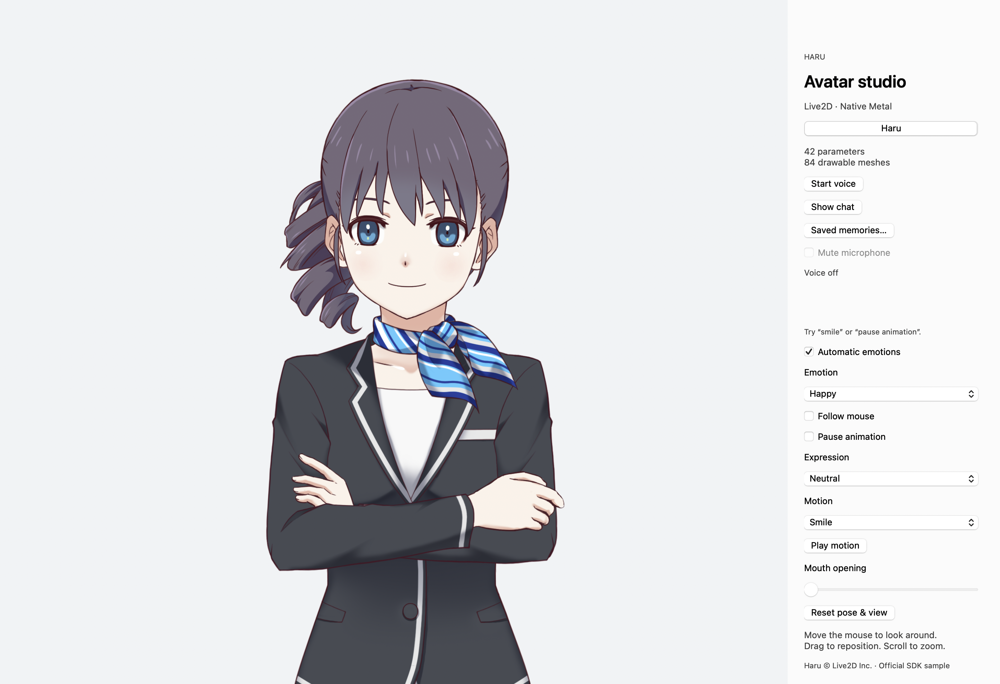
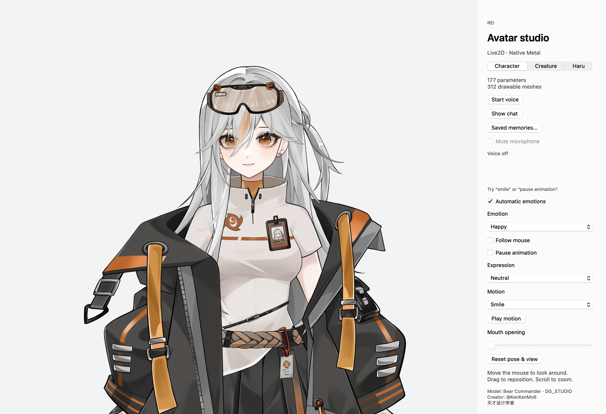
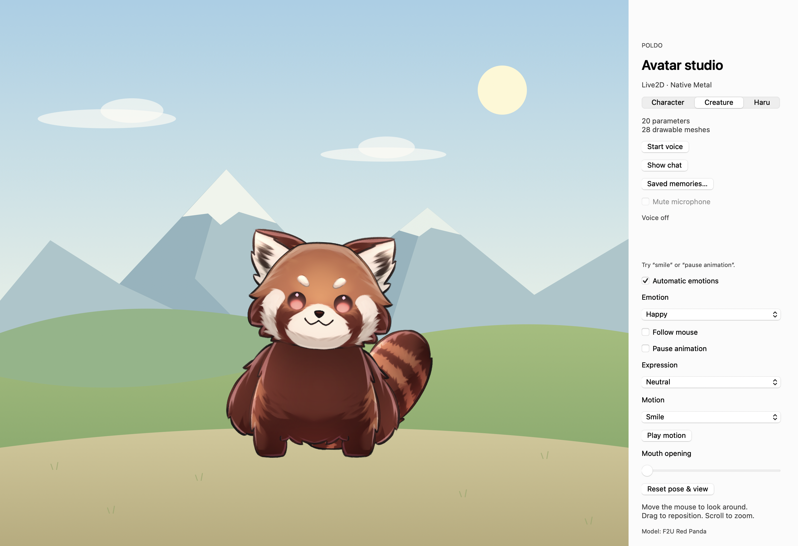

# Live2D Avatar for macOS

A native Swift companion with a Live2D avatar, Metal rendering, optional voice
conversation, and persistent character memory. No browser renderer or separate
application server is required.

## Character gallery

### Haru · standard build

<p align="center">
  
</p>

Haru opens by default in the standard build, framed from the upper body.
Haru artwork © Live2D Inc.; screenshots and model artwork retain the
[sample's separate terms](https://www.live2d.com/en/learn/sample/haru/).

### Rei · personal build default

<p align="center">
  
</p>

The personal build opens with Rei selected. Rei uses **Bear Commander** by
**DG_STUDIO / @KenKenMo6 / 天才设计学家**.

### Poldo · creature

<p align="center">
  
</p>

Poldo uses the **F2U Red Panda** model; the meadow is drawn by the app.
Rei and Poldo are optional models from our private setup. Their model files are not
included or downloaded by normal setup; **Haru remains the standard build's default**.
Model artwork and screenshots retain their creators' rights and are not covered
by the app's MIT license.

## What you can do

- Animate the avatar locally with blinking, breathing, physics, expressions and motions.
- Drag to reposition, scroll to zoom, and optionally let the character follow the pointer.
- Talk through native WebRTC; the assistant's received audio drives mouth opening.
- Read a separate chat window with captions and clickable web-search sources.
- Save explicit facts for each character. New sessions load them automatically;
  saved corrections take precedence over older reference profiles.
- Load another creator's Cubism runtime model from a local directory.

Rendering and manual controls work without an API key. Voice, web search and
semantic emotion decisions are optional online features. Camera tracking and
phoneme-level lip sync are not implemented.

## What is in this repository?

**Application and Swift/Objective-C++ glue source: yes. Live2D SDK and model files: no.**

Setup obtains the official **Cubism SDK for Native 5-r.4.1** and its **Haru** sample
into ignored local folders. Build then embeds the required runtime files in your
local `.app`. The source export contains no Cubism Core binaries/headers, Framework
source tree, model textures, `.moc3` files, purchased models, or private memories.

Our code is [MIT licensed](LICENSE). Live2D's runtime and sample artwork have
[separate terms](THIRD_PARTY_NOTICES.md); the complete runtime is not MIT licensed.

## Requirements

- macOS 14 or newer and a Metal-capable Mac.
- Swift 6.1 or newer. Install Apple's Xcode command-line tools or a compatible Xcode.
- Python 3, Git, and Apple's `xcrun`, `lipo`, `codesign` and `ditto` tools.
- Internet access for the initial SDK download and pinned SwiftPM dependencies.
- Optional: an OpenAI API project with access to the configured voice and backend models.

Check your tools:

```sh
xcode-select --install   # only if command-line tools are not installed
swift --version
python3 --version
xcrun --find lipo
```

Apple Silicon is the tested platform. Setup creates a Core library containing both
ARM64 and x86_64; Intel execution has not been verified here.

## Install and run

Start in the extracted source folder or clone this clean application repository:

```sh
git clone https://github.com/makevoid/live2d-avatar-swift.git
cd live2d-avatar-swift
```

### 1. Obtain the SDK and default model

Review the [SDK download terms](https://www.live2d.com/en/sdk/download/native/),
[Haru sample terms](https://www.live2d.com/en/learn/sample/haru/), and
[third-party notices](THIRD_PARTY_NOTICES.md).

**Manual download:** download `CubismSdkForNative-5-r.4.1.zip` from Live2D's
[official versioned archive](https://cubism.live2d.com/sdk-native/bin/CubismSdkForNative-5-r.4.1.zip),
then import it:

```sh
python3 scripts/setup.py --sdk-zip ~/Downloads/CubismSdkForNative-5-r.4.1.zip
```

**Setup download:** after reviewing and accepting the separate Live2D terms:

```sh
python3 scripts/setup.py --download --accept-live2d-licenses
```

Both routes verify the archive's pinned SHA-256, apply the small macOS Metal patch,
prepare the macOS Core slice, and install Haru. They do not download executable
installers or add model/SDK files to Git. Haru's prerecorded voice is excluded.
See [installation details](doc/installation.md) for paths and troubleshooting.

### 2. Build and open

```sh
./scripts/run.sh
```

The first build downloads WebRTC and Yams through SwiftPM. The result is
`build/Live2D Avatar.app`, locally ad-hoc signed. Double-click it in Finder on
subsequent launches. It is not notarized.

```sh
./scripts/build.sh                          # build without opening
CONFIGURATION=release ./scripts/build.sh    # optimized local build
./scripts/test.sh                           # offline tests + real GPU check
```

`rake` and `rake run` are optional shortcuts if Ruby/Rake is installed. To work in
Xcode, run setup and build once, then open `Package.swift`.

## Controls

| Control | Behavior |
| --- | --- |
| Drag / scroll on the avatar | Reposition / zoom |
| Follow mouse | Head, body and eyes follow the pointer |
| Expression | Play an expression authored in the loaded model |
| Motion + Play motion | Play an authored motion or generated mouth pose |
| Emotion / Automatic emotions | Hold a procedural emotion or allow conversational reactions |
| Mouth opening | Manually open the mouth; voice can open it further |
| Pause animation | Freeze the animation while keeping rendering active |
| Reset pose & view | Restore the model pose and framing |
| Show chat / ⌘⇧C | Open or hide the separate conversation window |
| Saved memories… | Inspect or clear facts saved for the current character |

Haru is the default. Only models actually bundled in the app appear in its selector.
The available expressions and motions come from the model manifest. Manual pose
changes turn off automatic emotions so the selected look can hold.

## Optional voice and chat

The current client uses `gpt-live-1` for native WebRTC voice and `gpt-6-luna` for
Responses delegation and emotion decisions. Your API project must have access to
these models; an API key alone does not guarantee availability. The renderer does
not depend on those services.

Supply `OPENAI_API_KEY` when launching the executable from a shell, or put only the
key in `~/.openai_api_key` for Finder launches. Restrict that file to your account:

```sh
chmod 600 ~/.openai_api_key
```

Never commit credentials. Click **Start voice**, allow microphone access, and speak.
Try “smile”, “pause animation”, or “remember that I prefer Swift”. Memory changes
show the exact fact and character for confirmation. **Mute microphone** keeps the
session connected; **Stop voice** ends it. API usage is billed to your OpenAI project.

Set `OPENAI_VOICE_BACKEND_MODEL` to override the backend with a compatible model.
See [voice and privacy](doc/voice.md) for credential handling, data flow and limitations.

## Memory that survives sessions

Explicit facts live in `~/Library/Application Support/Live2DAvatar/haru.yaml`
(and separate files for other configured characters). They are local, unencrypted,
owner-readable YAML. Each voice Start reloads them into both voice and backend
context; confirmed changes refresh recall during the session.

The app optionally reads `memory_data/mem_private.md`, falling back to
`mem_public.md` in the source checkout. Neither is bundled by the build script.
No user identity or biography is assumed by default. Facts follow this precedence:

1. Your latest direct correction in the conversation.
2. The current character's saved corrections, newest first in priority.
3. The selected reference profile.
4. Public or web information.

A read-only profile cannot override a saved correction. **Clear chat** only clears
the display. **Forget all** clears saved facts for that character, not the profile
or the model's existing conversation context. Restart voice to clear that context.
More details: [memory and delegation](doc/delegation.md).

## Use your own model

Obtain a Cubism **runtime export** you are permitted to use: one `.model3.json`,
its `.moc3`, textures, and referenced physics, expressions and motions. An editor
project (`.cmo3`) or a VTube Studio settings file alone is not enough.

```sh
mkdir -p local-assets/custom
python3 scripts/prepare-model.py "/path/to/MyModel/runtime" "local-assets/custom/MyModel"
"build/Live2D Avatar.app/Contents/MacOS/Live2DAvatar" \
  --model "$PWD/local-assets/custom/MyModel"
```

The app loads that model locally; it does not upload its files. See the
[complete model guide](doc/models.md) for folder structure, expressions, limits,
adding a persona and memory, and bundling another model intentionally.

## Optional personal asset collection

Owners of a separate private asset repository can load the Rei/Poldo integration
with one task after normal SDK setup:

```sh
PRIVATE_ASSETS_REPO=git@github.com:YOUR_ACCOUNT/YOUR_PRIVATE_ASSETS.git rake private
```

This clones into ignored `local-assets/private/`, validates both models, links local
reference profiles, and opens `build/Live2D Avatar Private.app` with Rei selected.
Later, `rake private`
reuses that checkout. Git authentication must already grant access to the private repo.
The ordinary build still produces the Haru app. Neither build bundles profiles, and
source packaging excludes the private checkout. See the [private setup guide](doc/private-assets.md)
for the layout, updates, and a command that does not require Rake.

## Verification and contributing

`./scripts/test.sh` runs the offline Swift suite and a Metal smoke test. It checks
visible rendering, changed animation pixels, all Haru expressions and full motion
durations, generated mouth-pose endpoints, and saved-memory recall across restarts.
Results and PNGs appear in `build/verification/`. No microphone or API calls are
needed. Opt-in live API tests are separate and billed.

The app has three main layers:

- `Sources/Live2DAvatar/`: AppKit UI, Metal rendering, model loading and GPU checks.
- `Sources/AvatarBehavior/`: personas, emotions, transcripts and persistent memory.
- `Sources/GPTLiveSwift/`: native WebRTC, session lifecycle and Responses delegation.

`vendor/swift-cubism/` retains the MIT bridge. Setup installs the separately licensed
Framework and Core beside it. [Architecture](doc/architecture.md),
[bridge changes](vendor/swift-cubism/LOCAL_CHANGES.md), and [AGENTS.md](AGENTS.md)
describe the development boundaries.

Before sharing source, run:

```sh
python3 scripts/package-source.py
```

This creates an audited source-only ZIP under `build/`. It excludes downloaded SDKs,
models, bundles, credentials, profiles and Git history even after a local build.
Do not upload the whole working directory or your locally built app as source.

## Credits and release terms

Built on [nslogmeng/swift-cubism](https://github.com/nslogmeng/swift-cubism),
[Live2D Cubism](https://www.live2d.com/en/sdk/about/),
[stasel/WebRTC](https://github.com/stasel/WebRTC), and [Yams](https://github.com/jpsim/Yams).
Haru is © Live2D Inc., downloaded from the official SDK.

Publishing application source does not grant redistribution rights for SDKs or
models. Before releasing a compiled app, review Live2D's
[SDK release-license requirements](https://www.live2d.com/en/sdk/license/), including
its rules for applications that load user-supplied models, and the model creator's
terms. See [THIRD_PARTY_NOTICES.md](THIRD_PARTY_NOTICES.md).
